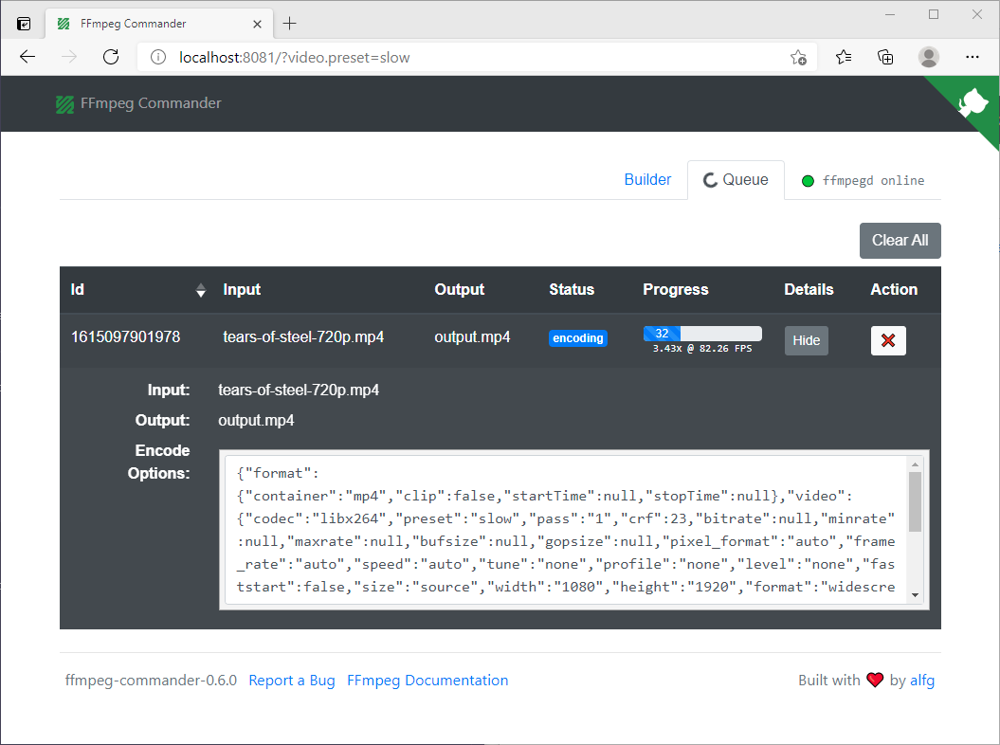

# `ffmpegd`
[FFmpeg](https://www.ffmpeg.org/) websocket server and API for [FFmpeg Commander](https://ffmpeg-commander.com).

[](https://pkg.go.dev/github.com/alfg/ffmpegd)
[](https://goreportcard.com/report/github.com/alfg/ffmpegd)

[](https://github.com/alfg/ffmpegd/actions/workflows/go.yml)
[](https://github.com/alfg/ffmpegd/actions/workflows/docker.yml)
[](https://github.com/alfg/ffmpegd/actions/workflows/release.yml)

## How It Works
`ffmpegd` connects [FFmpeg Commander](https://ffmpeg-commander.com) to [ffmpeg](https://www.ffmpeg.org/) by providing a websocket server to send encode tasks and receive realtime progress updates back to the browser. This allows using `ffmpeg-commander` as a GUI for `ffmpeg`.

The goal is to provide a simple interface for sending FFmpeg tasks from the browser (and other supported clients in the future) to your local machine.

See [Usage](#Usage) for more details.

### Versions
`ffmpegd` and `ffmpeg-commander` share version numbers: releases with the same major.minor version (2.1.x with 2.1.x) speak the same payload format. Update `ffmpegd` when ffmpeg-commander moves to a new minor version.

```
          process              websocket
[ffmpeg] <-------> [ffmpegd] <-----------> [ffmpeg-commander]
```

## Install
### Homebrew
Installs `ffmpegd` along with `ffmpeg`:
```
$ brew install alfg/tap/ffmpegd
```

### Go
Requires Go 1.26 or newer:
```
$ go install github.com/alfg/ffmpegd@latest
```

### Download
Release binaries for your platform at:
https://github.com/alfg/ffmpegd/releases

### Docker
A Docker image with an [alfg/ffmpeg](https://github.com/alfg/docker-ffmpeg) build installed is available on the GitHub Container Registry:
```
$ docker run -it -p 127.0.0.1:8080:8080 -v /tmp/:/home ghcr.io/alfg/ffmpegd
```

Or using the Docker Compose example:
```
$ docker compose up ffmpegd
```

## Usage
* [ffmpeg](https://www.ffmpeg.org/download.html) must be installed and available on your `$PATH`.
* Run `ffmpegd`:
```
$ ffmpegd
```

This will start the websocket server in your current working directory and wait for a connection. Input and output paths are relative to this directory.

* Go to https://ffmpeg-commander.com/ in the browser
* Enable `ffmpegd` in Options.
* Once connected, you can start sending encode jobs to ffmpegd!

### Options
```
$ ffmpegd help

Usage:
  ffmpegd [--host address] [port]   Run server on localhost:8080 by default.
  ffmpegd version                   Print version.
  ffmpegd help                      This help text.

Options:
  --host address   Address to listen on. Use 0.0.0.0 to let other machines on
                   your network connect. Can also be set with $FFMPEGD_HOST.
```

By default `ffmpegd` only accepts connections from your own machine. Only listen on other addresses on a network you trust: anyone who can reach `ffmpegd` can run encodes and list files in its directory.

## Example
### `ffmpegd` with a job in progress from `ffmpeg-commander`
```
$ ffmpegd

███████╗███████╗███╗   ███╗██████╗ ███████╗ ██████╗ ██████╗
██╔════╝██╔════╝████╗ ████║██╔══██╗██╔════╝██╔════╝ ██╔══██╗
█████╗  █████╗  ██╔████╔██║██████╔╝█████╗  ██║  ███╗██║  ██║
██╔══╝  ██╔══╝  ██║╚██╔╝██║██╔═══╝ ██╔══╝  ██║   ██║██║  ██║
██║     ██║     ██║ ╚═╝ ██║██║     ███████╗╚██████╔╝██████╔╝
╚═╝     ╚═╝     ╚═╝     ╚═╝╚═╝     ╚══════╝ ╚═════╝ ╚═════╝
                                                      v2.1.0

[ffmpegd] - websocket server for ffmpeg-commander.

  Checking FFmpeg version....9.0.1
  Checking FFprobe version...9.0.1

  Server started on http://localhost:8080.
  - Go to https://ffmpeg-commander.com to connect!
  - ffmpegd must be enabled in ffmpeg-commander options.

Encoding tears-of-steel.mp4 -> tears-of-steel-720p.mp4
Encoding... 34.68% 3.37x @ 80.77 fps
```


## WebSocket Demo
See [demo](demo/) for a websocket client example. The demo generates and reuses a
stable `clientId` in `localStorage`, cancels by server task id, and reconnects
automatically.

## WebSocket task lifecycle

Every encode owns a stable id and a submitter identity. Task events are sent
only to websocket connections registered for that submitter; they are no longer
broadcast to every client.

### Client -> server

```jsonc
// Submit (all identity fields are optional). payload may be the historical
// JSON string or a raw JSON object.
{ "type": "encode",
  "clientId": "browser-abc123",      // stable submitter id, reused on reconnect
  "clientTaskId": "ui-1",            // optional caller correlation token
  "input": "in.mp4", "output": "out.mp4", "payload": "..." }

// Cancel precisely one task, by server id or clientTaskId.
{ "type": "cancel", "taskId": "7" }

// Re-announce identity after (re)connecting; the server then replays the
// submitter's unfinished tasks as "snapshot" events.
{ "type": "identify", "clientId": "browser-abc123" }

{ "type": "query", "taskId": "7" }   // one current snapshot
```

`client_id`/`owner`/`submitter_id`, `task_id`/`id`/`jobId` and numeric `seq`
aliases are all accepted. A websocket may also present its identity as
`/ws?clientId=...`. Ids are owner-scoped for websocket requests: a connection
can only query or cancel its own tasks, so sequential ids cannot be enumerated
to reach another submitter's work. An id-less `cancel` preserves the old
behavior and cancels the submitter's running task (falling back to the
process-wide current task).

### Server -> client

Every phase carries the same server-assigned `taskId` (also under `id`,
`task_id`, `jobId`), the numeric `seq`, the echoed `clientTaskId`, and the
submitter identity (`clientId`/`owner`/`submitterId`/`submitter_id`):

```
identified | accepted | started | progress | completed | failed | cancelled
snapshot | cancel-ack | error
```

Lifecycle guarantees:

* `accepted` is always written before `started`/progress for a task.
* A queued task cancelled before it is dequeued is marked cancelled and the
  dispatcher skips it: ffmpeg is never started and it gets exactly one
  `cancelled` terminal event.
* Cancelling a running task kills its ffmpeg process. Progress after the
  cancel transition is dropped, and exactly one terminal event is emitted.
* Cancelling an unknown id returns an `error` (`task ... not found`);
  cancelling a retained finished task returns `task "<id>" already completed|
  failed|cancelled`. Repeated cancels never produce a second terminal event.
* On reconnect with the same `clientId`, the server sends `snapshot` events
  for the submitter's unfinished tasks and subsequent progress continues to
  flow. Other submitters never receive those events.
* A full queue rejects submission with a clear `error` and removes the
  temporary record, so the rejected `clientTaskId` cannot later be cancelled.
* Finished records are retained briefly (for late cancel/reconnect lookups),
  then reaped. Server shutdown cancels work and clears every record.

## Develop
Requires Go 1.26 or newer and `ffmpeg`/`ffprobe` on your `$PATH`.
```
go build -v
./ffmpegd
```

#### Tests
```
go test ./...
go test -race ./cmd/...
```

The `cmd` package includes deterministic websocket lifecycle tests (queue
cancellation, running cancellation, reconnect ownership, terminal-state races,
queue-full rejection, cleanup/shutdown). Tests that shell out to real
`ffmpeg`/`ffprobe` skip automatically when the binaries are not on `PATH`.

## TODO
* Logging levels and output

## License
MIT
